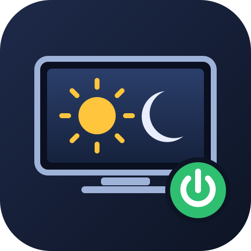
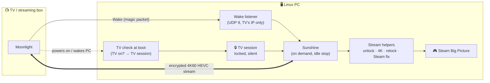
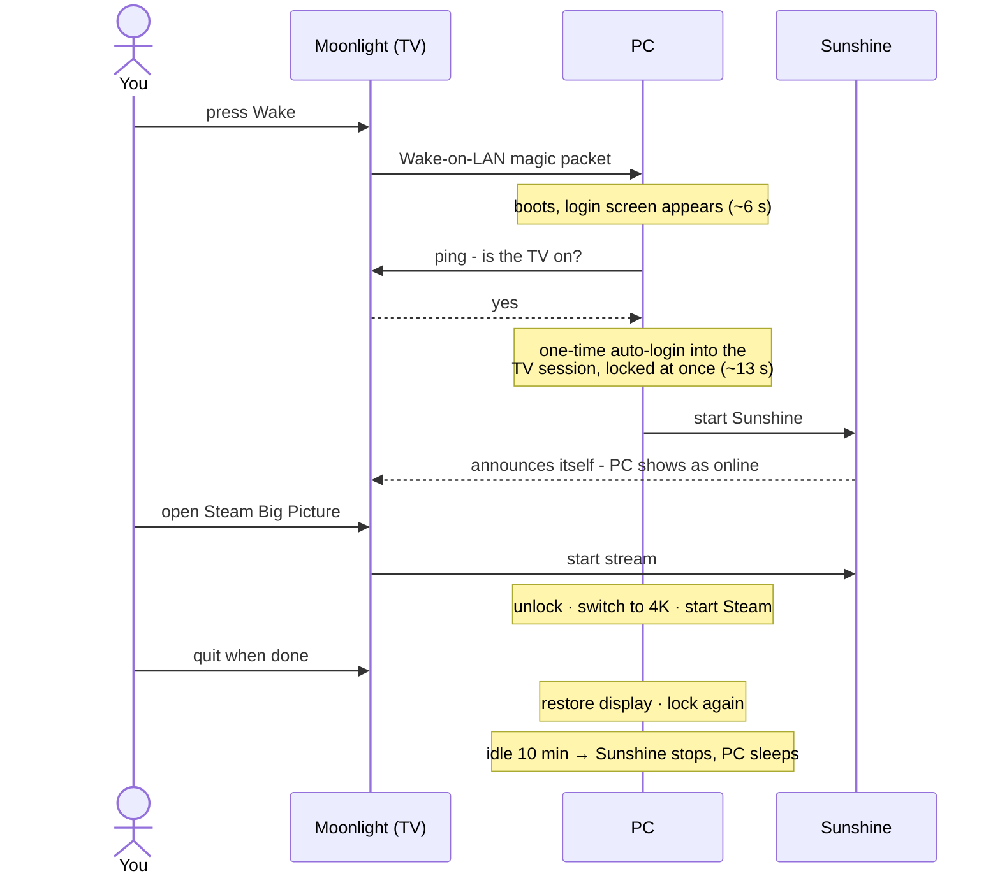

<p align="center"></p>

# sunshine-on-demand

**Couch gaming from your PC on your TV: press Wake on the TV, play.**

Built on [Sunshine](https://github.com/LizardByte/Sunshine) + [Moonlight](https://moonlight-stream.org). One press of **Wake** in Moonlight wakes the PC, even from **power-off**. The PC comes up in a locked, silent "TV session", the stream unlocks it, switches the display to 4K and opens Steam Big Picture. When you're done, everything is put back and locked again. Sunshine only runs while you play, and the firewall only lets your TV in.

## How it works


<details>
<summary><b>One press from power-off, step by step</b></summary>


</details>

## Works with
| | Status |
|---|---|
| **Linux + KDE Plasma 6** | ✅ everything, tested ([reference setup](docs/reference-setup.md)) |
| Linux + GNOME / Sway / Hyprland / X11 | 🟡 everything except the cold-boot TV session (needs KDE's KWin); untested |
| Windows 10/11 | 🛠 guided, experimental ([docs/windows.md](docs/windows.md)) |
| macOS | ❌ (Sunshine on macOS has no gamepad support) |
| **TVs:** Android/Google TV, Nvidia Shield, LG webOS, Samsung Tizen, Apple TV, Fire TV (Fire OS) | ✅ / 🟡 see [docs/tv-clients.md](docs/tv-clients.md) |
| Hisense VIDAA, Roku, Fire TV on Vega OS | ❌ no Moonlight app: use a streaming box |

**You need:** the PC on **Ethernet**, a Moonlight-capable TV or box, and Wake-on-LAN enabled in the PC's BIOS. Full matrix: [docs/compatibility.md](docs/compatibility.md).

## Install with Claude Code (recommended)
In [Claude Code](https://claude.com/claude-code) on the gaming PC:

```
/plugin install sunshine-on-demand --marketplace NichoBricko/tv-streaming
/sunshine-on-demand:setup
```

Claude:
- asks about your TV and controller, and checks your PC;
- tells you what will work on your setup;
- installs everything and installs Moonlight on your TV where it can (Android TV/Fire TV via adb, LG via Developer Mode);
- pairs it and tests it with you.

You'll be asked to run the few commands that need your password in your own terminal.

<sub>Older Claude Code: `/plugin marketplace add NichoBricko/tv-streaming`, then `/plugin install sunshine-on-demand@nichobricko`. Problems later: `/sunshine-on-demand:troubleshoot`.</sub>

## Install manually (Linux)
1. Install Sunshine ([per distro](docs/linux.md#1-install-sunshine)), and give your TV a fixed IP in your router.
2. Configure and install:
   ```bash
   git clone https://github.com/NichoBricko/tv-streaming ~/.local/share/sunshine-on-demand && cd ~/.local/share/sunshine-on-demand
   ./setup.sh configure --client-ip <TV IP>     # detects your PC, writes config.env - review it
   ./setup.sh install                           # asks for sudo for the system part
   ```
3. Enable Wake-on-LAN in your BIOS ([vendor table](docs/linux.md#3-wake-on-lan-in-the-biosuefi)).
4. Install Moonlight on the TV ([per TV](docs/tv-clients.md)) and pair it: `sunshine-on-demand start`, open https://localhost:47990, and enter the PIN.

Details and testing: [docs/linux.md](docs/linux.md).

## Everyday use
1. On the TV, open **Moonlight**. If the PC shows as offline, press **Wake** and wait about 15 s.
2. Start **Steam Big Picture** and play.
3. **Quit** the stream when done. Everything resets itself.

## Security in brief
- Sunshine runs only on demand.
- Only your **paired** TV can connect; the firewall only allows **its IP**; the stream is **encrypted**.
- A Wake never unlocks anything: the session is unlocked only for a paired client's stream, and locked again afterwards.
- The TV can't type, move the mouse, or show your desktop; it only gets Steam Big Picture.

Details: [docs/how-it-works.md](docs/how-it-works.md#security-model).

## Documentation
| | |
|---|---|
| [How it works](docs/how-it-works.md) | components, TV session, security model |
| [Linux install](docs/linux.md) · [Windows (experimental)](docs/windows.md) | manual setup |
| [TV clients](docs/tv-clients.md) | Moonlight per TV platform, pairing, standby check |
| [Compatibility](docs/compatibility.md) | what works where |
| [Troubleshooting](docs/troubleshooting.md) | symptoms, logs (`./setup.sh report`), lessons learned |
| [Reference setup](docs/reference-setup.md) | the tested hardware |
| Extras | [LG webOS Developer Mode + stream stats](extras/lg-webos-devmode/README.md) · [Xbox controller Bluetooth dropouts](extras/xbox-controller-bluetooth/README.md) · [RDR2 (Epic) via Heroic](extras/rdr2-epic-heroic/README.md) |

**Uninstall:** `./setup.sh uninstall` (preview it first with `--dry-run`).

## License & credits
[MIT](LICENSE) © NichoBricko. Built on [Sunshine](https://github.com/LizardByte/Sunshine) (LizardByte), [Moonlight](https://moonlight-stream.org), [Moonlight TV](https://github.com/mariotaku/moonlight-tv) (mariotaku) and [Moonlight for Tizen](https://github.com/brightcraft/moonlight-tizen). Not affiliated with any of them.
